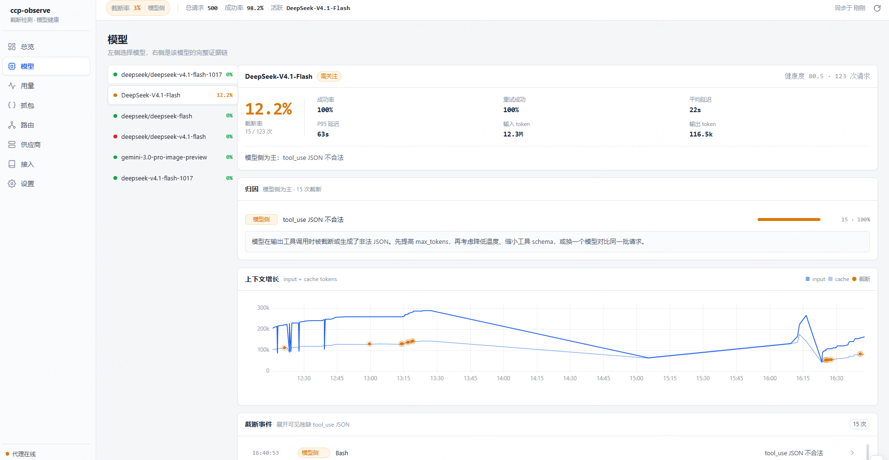
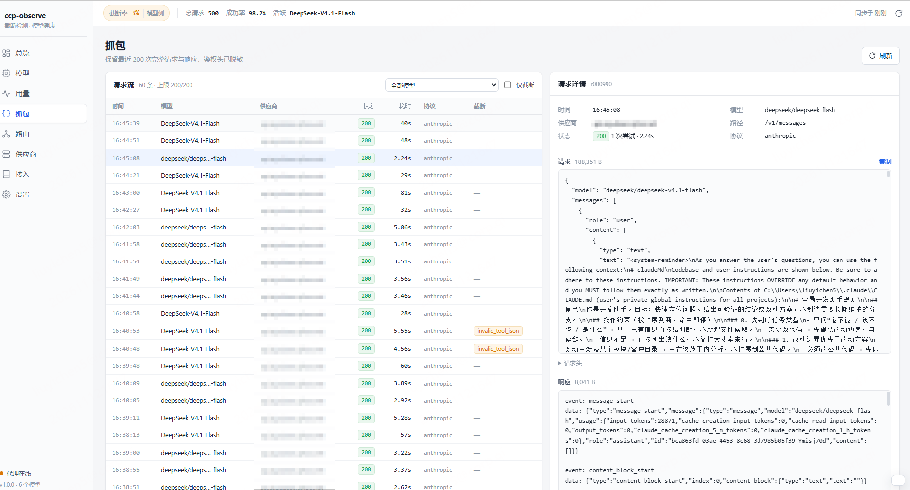
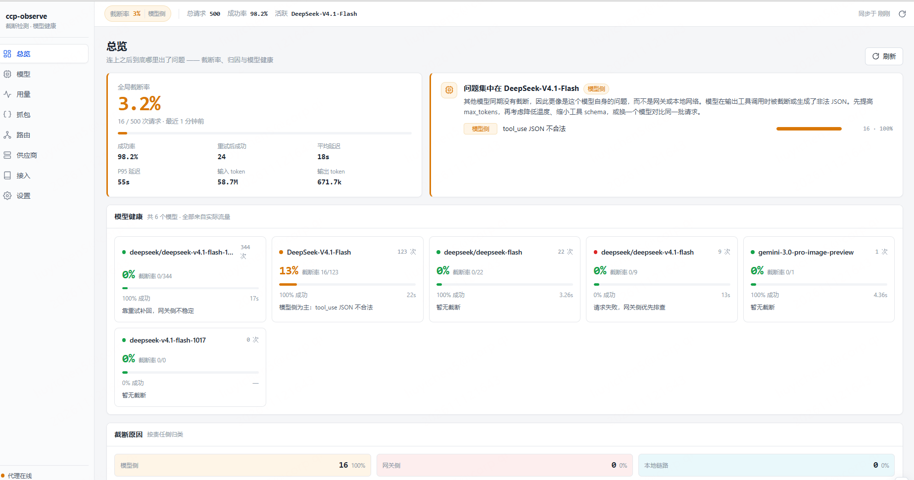
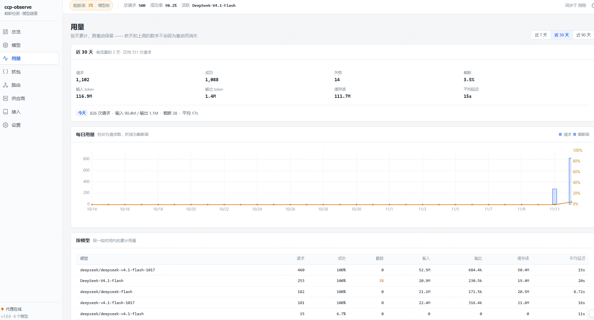

<sub>Upstream 502s, a stream that dies mid-sentence, tool_use JSON missing a brace — same face.</sub>

<div align="center">


# ccp-observe

A local AI gateway you can actually see into<br>
Know exactly what every Claude Code / Codex request did

[](../../releases/latest)
[](LICENSE)
[](https://www.python.org/)
[](#)
[](proxy/tests)
[](#)

[简体中文](README.md) | [English](README.en.md)

</div>

---

## Introduction

Point your AI coding agent's API endpoint at one port on your machine and watch what it actually does: request volume and success rate, tool_use truncation events (including the broken JSON fragments), retries and latency, context growth, token usage, and per-model health.

It is also a working local gateway: multiple providers, model/path based routing, Anthropic ⇄ OpenAI protocol translation, and full request capture. No login, no cloud, no intranet dependency — you supply the providers and upstream URLs, and every byte stays on this machine.

```
Claude Code ──┐                        ┌── Anthropic-compatible upstream
              ├─→ ccp-observe:8787 ────┤
Codex ────────┘  route / translate /  └── OpenAI-compatible upstream
                 capture
```

The problem it solves is not "one more log viewer". It is a very specific one: when truncation happens, is it the model, the gateway, or the local link? So the truncation rate is a first-class citizen on the page — never buried in a sub-page.

<table>
<tr><td width="50%">

Browser panel<br>
`http://127.0.0.1:8787/_ccp/`<br>
Served by the proxy itself, zero install

</td><td width="50%">

Desktop app<br>
`desktop/` (Tauri 2)<br>
Lives in the tray, starts/stops the proxy, embeds the same panel

</td></tr>
</table>

The panel source lives in `web/` and builds into `proxy/static/`, so both forms show exactly the same page. Ports avoid conflicts: if 8787 is taken it moves to 8788, 8789, … and prints a `CCP_READY <url>` handshake line that the desktop app parses to open the right port.

---

## Install with AI

Copy the whole block below into your AI coding assistant (Claude Code, Codex, Cursor, Trae, …). It will install, start, take over your client, and verify everything. You do not need to understand any of the configuration first.

> Prerequisite: having only one of Claude Code or Codex installed is fine. If you have neither, skip step 5 — running the proxy alone is still useful.

````text
Install and configure ccp-observe (a local AI gateway observability proxy) on this machine.
Follow these steps in order and report the result after each one:

1. Check the environment
   - Run `python --version` (on Windows, if that fails try `py -3 --version`); confirm Python >= 3.9.
   - Record the current directory. All following commands run from the project root
     (the directory containing proxy/, bin/ and start.sh).

2. Install dependencies
   - This project has zero third-party dependencies; no pip install needed.
   - If proxy/static/index.html does not exist (panel not built), make sure Node 18+ and npm are
     available, then in web/ run: `npm ci || npm install`, then `npm run build`.
     If Node is unavailable, skip this step and go to step 3; the start script will warn about
     the missing panel.

3. Start the proxy
   - macOS / Linux / Git Bash: `chmod +x start.sh && ./start.sh --no-open`
   - Windows PowerShell: `Set-ExecutionPolicy -Scope Process -ExecutionPolicy Bypass; .\start.ps1 -NoOpen`
   - Or directly: `python proxy/proxy.py`
   - Read the `CCP_READY http://127.0.0.1:<port>/_ccp/` line from the output and note the actual
     port (default 8787; it shifts automatically if the port is taken).

4. Verify the proxy is alive
   - Request `http://127.0.0.1:<port>/healthz`; expect 200.
   - Request `http://127.0.0.1:<port>/_ccp/api/stats`; expect JSON (empty stats are fine here).

5. Take over the client (do either or both)
   - Generic: run `ccp` (the Windows installer adds bin/ to the user PATH; otherwise run
     `python proxy/ccp_launch.py`).
     - `ccp --agent list` shows installed clients and the current default.
     - `ccp --doctor` only checks, does not launch the client.
     - `ccp claude` or `ccp codex` selects a client explicitly.
   - Manual (does not modify any existing config file):
     - Claude Code: set `ANTHROPIC_BASE_URL=http://127.0.0.1:<port>`, and set
       `ANTHROPIC_AUTH_TOKEN` to a placeholder (the real upstream auth is configured on the
       panel's "Providers" page).
     - Codex: prefer `ccp codex`.

6. Configure an upstream (required, otherwise the proxy rejects requests with a hint)
   - Open the panel at `http://127.0.0.1:<port>/_ccp/`, go to "Providers", and add one:
     any name, protocol `anthropic` or `openai`, Base URL set to your upstream (e.g.
     https://example.internal/v1), auth header `Authorization: Bearer <key>`, enabled checked.
   - If your ~/.claude/settings.json already has ANTHROPIC_BASE_URL and a token, or
     ~/.codex/config.toml already has a model_provider, run `ccp --reimport` and ccp will
     import them as providers for you, skipping manual entry.

7. Smoke test and report
   - Send a test request:
     curl http://127.0.0.1:<port>/v1/messages -H "content-type: application/json" \
       -d '{"model":"your-model","max_tokens":32,"messages":[{"role":"user","content":"hi"}]}'
   - Then request `/_ccp/api/recent?limit=5` and confirm this request is visible.
   - Report: Python version, actual listening port, which client was taken over, whether the
     provider was configured successfully, and the smoke request's HTTP status code.

Notes:
- Never write any real API key into repository files, commits, or logs.
- Do not modify the existing contents of ~/.claude/settings.json or ~/.codex/config.toml;
  ccp only layers temporary configuration at runtime.
- Codex must route to a provider whose protocol is openai, otherwise it returns
  ccp_unsupported_translation (Responses and Anthropic Messages cannot be translated).
- If /healthz does not respond, read the proxy error in the terminal first; do not restart blindly.
````

After installation you only need `ccp`. It starts the proxy when needed, points the selected client at it, and leaves everything else untouched.

---

## Install yourself

### Option 1: Installer (Windows, easiest)

Download from [Releases](../../releases/latest) and install either one:

| File | Notes |
| --- | --- |
| `ccp-observe_1.0.0_x64-setup.exe` | NSIS installer, smaller |
| `ccp-observe_1.0.0_x64_en-US.msi` | MSI installer, better for enterprise distribution |

The installer appends `<install dir>\resources\bin` to the current user's PATH (removed on uninstall), so a new terminal can run `ccp` directly. The desktop app starts the proxy on launch, the tray icon toggles the panel, and the "Quit (stop proxy)" menu item terminates the child process too.

> Verify integrity: `sha256sum -c SHA256SUMS.txt` (use `Get-FileHash` in PowerShell). The installer already contains the built panel, so Node.js is not required, but the target machine needs Python 3.9+.

### Option 2: Run from source (all platforms)

Requirements: Python 3.9+. The repository already contains the built panel, so it works out of the box.

```bash
git clone <this repository> ccp-observe
cd ccp-observe

# macOS / Linux / Windows Git Bash
chmod +x start.sh && ./start.sh

# Windows PowerShell
Set-ExecutionPolicy -Scope Process -ExecutionPolicy Bypass
.\start.ps1
```

The start script checks Python, confirms the panel static files (building them with `npm` if missing), starts the proxy, opens the panel, and on first use prompts you to fill in an upstream.

You can also run the proxy directly:

```bash
python proxy/proxy.py                      # 127.0.0.1:8787
python proxy/proxy.py --port 8788 --open
python proxy/proxy.py --upstream https://example.internal/v1
```

### Take over your client with `ccp` (recommended)

```bash
ccp                  # auto-select an installed client (Claude Code / Codex) and launch it
ccp claude           # explicitly use Claude Code
ccp codex            # explicitly use Codex
ccp --agent list     # show installed clients and the current default
ccp --continue       # pass any client arguments through
ccp --doctor         # checks only: what was found, what was started
ccp --no-launch      # only make sure the proxy is running, do not launch a client
```

Client selection is automatic:

| Situation | Behaviour |
| --- | --- |
| Only Claude Code or only Codex installed | Silently use the one that exists |
| Both installed, first run | Asks once (Enter defaults to Claude Code); the choice is saved to `state/agent.json` |
| Every later run | Reuses the previous choice; `ccp codex` / `ccp claude` switch temporarily |
| Non-interactive (scripts, IDE tasks) | Does not ask; falls back to Claude Code |

What `ccp` does is zero-config takeover:

1. Reads your existing `~/.claude/settings.json` (and `settings.local.json`, which takes precedence) for `ANTHROPIC_BASE_URL`, `ANTHROPIC_AUTH_TOKEN` / `ANTHROPIC_API_KEY`, and custom model names;
2. Reads `~/.codex/config.toml` for the active `model_provider` (`base_url`, `env_key`, `wire_api`) and the top-level `model`, taking the key from the `env_key` environment variable or `~/.codex/auth.json`;
3. Writes the discovered upstreams into ccp-observe as providers — once; later edits you make in the panel are never overwritten (`--reimport` forces a re-import). If neither client has a configuration, the first run asks for a Base URL instead of launching into a 502. Starting `proxy/proxy.py` or the desktop app directly performs the same import, so a fresh start never has an empty provider list;
4. Finds a running ccp-observe, or starts a detached one (it keeps running after you close the terminal);
5. Points the selected client at that port without touching your original config:
   - Claude Code: generates a temporary settings file containing only `ANTHROPIC_BASE_URL` and passes it via `claude --settings <file>`, layered on top of your config;
   - Codex: overrides `model_providers` with `-c key=value` on the command line; `~/.codex/config.toml` stays untouched.

So after installation you don't need to change any environment variables: `claude` / `codex` keep connecting directly, `ccp` goes through the observability proxy, and the two never interfere.

### Configure your client manually

The panel's "Connect" page has one-click copy buttons; the content is exactly the two snippets below.

Claude Code

```bash
export ANTHROPIC_BASE_URL=http://127.0.0.1:8787
export ANTHROPIC_AUTH_TOKEN=your-key-if-any
# Upstream auth is configured on the "Providers" page; only a placeholder goes here
```

Codex

Prefer `ccp codex` (it injects the configuration below without touching your `~/.codex/config.toml`). The manual equivalent is:

```toml
# ~/.codex/config.toml
model_provider = "ccp"
web_search = "disabled"          # most compatible gateways reject the web_search tool with 400

[model_providers.ccp]
name = "ccp-observe"
base_url = "http://127.0.0.1:8787/v1"
env_key = "OPENAI_API_KEY"
wire_api = "responses"           # Codex 0.16x+ only supports responses
```

Any HTTP client

```bash
curl http://127.0.0.1:8787/v1/messages \
  -H "content-type: application/json" \
  -d '{"model":"your-model","max_tokens":32,"messages":[{"role":"user","content":"hi"}]}'
```

The proxy detects the protocol from the path: `/v1/messages` → Anthropic Messages, `/v1/chat/completions` → OpenAI Chat Completions, `/v1/responses` → OpenAI Responses (this is what Codex uses). Any request through the proxy is recorded automatically, with no extra configuration.

> Codex must route to a provider with `protocol = openai`. Responses API and Anthropic Messages are structurally incompatible and cannot be translated; if the default provider is anthropic, the request returns `ccp_unsupported_translation` with an explanation instead of sending a request that is guaranteed to fail. Add a rule on the "Routing" page (e.g. `gpt-*` → some openai provider).

### Configure upstreams and routing

Next, add a provider in the panel:

| Field | Description |
| --- | --- |
| Name / id | Display name in the panel; the id is referenced by routing rules |
| Protocol | `anthropic` / `openai` / `auto` (follow the client) |
| Base URL | Any compatible endpoint, e.g. `https://example.internal/v1`; the `/v1` is optional |
| Auth header | e.g. `Authorization: Bearer sk-xxx`; overrides the same header from the client |
| Models | Optional: declare the models this provider supports; leave empty to act as a fallback |
| Enabled | Disabled providers are skipped by routing |

Each provider card has a "Ping" button that sends one minimal request to measure connectivity and latency without recording statistics.

Routing is an ordered list of rules; the first match from the top wins. `match` can be a model glob (`deepseek-*`, `*sonnet*`) or a path glob (`/v1/messages*`), and `provider` points at a provider id. Resolution order:

```
routing rules → providers' declared model lists → default provider → legacy single upstream → unconfigured (502 guidance)
```

The hit-preview box on the "Routing" page updates live: type a model name or path and it shows which rule matches, which provider resolves, and whether translation is needed — the decision is visible, no guesswork.

When the provider only speaks OpenAI Chat Completions but the client speaks Anthropic Messages (or the reverse), enable "Settings → Protocol translation" and the proxy rewrites the request and streamed response chunk by chunk: `system` / `messages` / `tools` / `tool_use` / `tool_result` / `max_tokens` mapped both ways, with `content_block_*` ⇄ `choices[].delta` incremental conversion. When the upstream cuts the stream early it does not fabricate an end event — otherwise truncation would be laundered into a "normal finish" and the panel would lie.

All configuration is written to `proxy/state/config.json` (atomic replace) and takes effect immediately without a restart.

---

## Screenshots

All screenshots are from a real running panel (window captures, not full-page scroll captures; some content requires scrolling).

Overview: truncation rate, diagnostic verdict, per-model health



Usage (wide window): request, truncation and token breakdown by model / by provider



Overview (another window size)



Usage: daily request / token / latency accumulation with a truncation-rate line



---

## Features

There is exactly one design goal: figure out what went wrong after you connect.

| Module | Contents |
| --- | --- |
| Overview | Big global truncation-rate card + diagnostic verdict; model health card grid; truncation reasons split by responsibility; recent truncations (jump straight to the capture) |
| Models | Model list on the left, the full evidence chain for one model on the right: truncation rate, success rate, P95, context growth curve (with truncation markers), truncation events (expand the broken tool_use JSON), recent requests |
| Usage | Daily requests / successes / failures / truncations / input-output tokens / average latency with bars plus a truncation-rate line; also split by model and by provider. Persisted to disk — restarts, reboots, and yesterday's numbers all survive |
| Capture | Full request/response for every proxied call, headers auto-redacted, filter by model, truncations only; the detail page surfaces the broken tool_use fragment separately |
| Routing | Ordered rule table + hit preview; changes take effect immediately |
| Providers | Provider cards: protocol, address, models, ping, enable/disable |
| Connect | Environment variables and commands for Claude Code / Codex / curl, one-click copy |
| Settings | Listen address, retries and retention, capture toggle, protocol translation, model name mapping, self-test |

A few things worth calling out:

- Truncation rate in the status bar: a persistent global truncation rate (green / yellow / red) on every page, so the overall health is always one glance away.
- Truncation attribution: every truncation event is attributed to one side — `model` (max_tokens, invalid tool_use JSON), `gateway` (stream not properly terminated, upstream 5xx / in-stream error), `local link` (client disconnected early). The overview diagnostic card compares them side by side: only one model is dirty → model side; several models dirty at once → shared link/gateway; client disconnected voluntarily → local.
- Capture: a ring buffer keeps the last N (default 200) full requests/responses; request headers such as `authorization` / `x-api-key` / `api-key` / `cookie` are always shown as `***redacted***`; response bodies over 256 KB are truncated and labelled, while untruncated JSON is pretty-printed.

Model cards and the capture list come entirely from real traffic — there is no hard-coded model list anywhere.

---

## Desktop app

```bash
cd desktop
npm install                 # only installs @tauri-apps/cli
npm run bundle-proxy        # copies proxy/ into src-tauri/resources (tauri build does this too)
npm run dev                 # run in development
npm run build               # build installers (Windows: .msi/.exe; macOS: .dmg)
```

The Rust side does three things: start/stop the Python proxy child process, the tray icon, and the panel window. The tray icon toggles the panel, and "Quit (stop proxy)" terminates the child process too.

Prerequisites:

1. Rust toolchain (`rustup`, ≥1.77) and Node.js 18+;
2. On Windows, WebView2 Runtime (bundled with Win11) and WiX/NSIS (`tauri build` downloads them as needed);
3. The target machine needs Python 3.9+ (the desktop app runs the proxy as a child process), or point `CCP_PYTHON` at an interpreter.

The build automatically runs `scripts/bundle_proxy.mjs` to copy the runtime files of `proxy/` and `bin/` into `src-tauri/resources/`. The Windows installer also invokes `desktop/src-tauri/installer-hooks.nsh`, which appends `<install dir>\resources\bin` to the current user's PATH on install (and removes it on uninstall).

---

## Project layout

```
ccp-observe/
├── proxy/                 Python proxy (zero third-party dependencies)
│   ├── proxy.py           entry point, prints the CCP_READY handshake line
│   ├── ccp/
│   │   ├── config.py      layered config: defaults → config.json → CCP_* env vars
│   │   ├── protocol.py    dual-protocol detection, upstream URL joining, usage extraction
│   │   ├── router.py      provider resolution and ordered routing rules (with dry-run preview)
│   │   ├── translate.py   Anthropic ⇄ OpenAI request / streaming response translation
│   │   ├── capture.py     capture ring buffer, header redaction, response body truncation
│   │   ├── truncation.py  SSE truncation detection (Anthropic / OpenAI Chat / Responses)
│   │   ├── stats.py       request ledger and panel aggregation
│   │   ├── usage.py       daily persisted usage ledger (models / providers / total)
│   │   ├── claude_env.py  import upstream, auth and model names from ~/.claude/settings.json
│   │   ├── codex_env.py   import upstream and auth from ~/.codex/config.toml + auth.json
│   │   └── server.py      routing, SSE passthrough, retries, panel API
│   ├── ccp_launch.py      the `ccp` command: import config → start/reuse proxy → launch claude or codex
│   ├── static/            built panel (Vite output)
│   ├── tests/             58 integration/unit tests (routing, translation, capture, usage)
│   ├── demo_upstream.py   local mock upstream (for demos)
│   └── seed_demo.py       generates demo traffic
├── bin/                   `ccp` command wrappers (ccp.cmd / ccp / PATH registration script)
├── web/                   panel source (Vite + vanilla JS + uPlot)
├── desktop/               Tauri 2 desktop shell
├── docs/images/           README screenshots
├── start.sh / start.ps1   one-command start scripts
└── README.md
```

---

## Panel API

The panel and the desktop app only read data through the relative path `/_ccp/api/*`:

| Method | Path | Description |
| --- | --- | --- |
| GET | `/_ccp/api/stats` | Overview + per-model aggregates + protocol mix + status |
| GET | `/_ccp/api/recent?model=&limit=` | Recent requests |
| GET | `/_ccp/api/errors` | Failed requests |
| GET | `/_ccp/api/truncations?model=` | Truncation events (including tool_call fragments) |
| GET | `/_ccp/api/context?model=` | Context series |
| GET | `/_ccp/api/buckets?model=&granularity=day\|week\|month` | Time-bucketed stats (in-memory ring buffer) |
| GET | `/_ccp/api/usage?days=` | Daily persisted usage ledger: `days` / `models` / `providers` / `summary` |
| GET/POST | `/_ccp/api/config` | Read / hot-update configuration |
| POST | `/_ccp/api/test` | Test upstream connectivity (optionally with a `provider` id) |
| GET/POST | `/_ccp/api/route?model=&protocol=` | Routing decision preview (dry run, sends no request) |
| POST | `/_ccp/api/routes/validate` | Validate one rule (`match` + `provider`) |
| GET | `/_ccp/api/capture?model=&limit=&truncated=1` | Capture list |
| GET | `/_ccp/api/capture/<id>` | Single capture detail (redacted headers and broken fragments) |
| GET | `/_ccp/api/selftest` | Self-test |
| GET | `/healthz` | Liveness probe |

---

## Environment variables

| Variable | Purpose |
| --- | --- |
| `CCP_HOST` / `CCP_PORT` | Listen address and port (default `127.0.0.1:8787`; shifts when the port is taken) |
| `CCP_UPSTREAM` | Generic upstream URL |
| `CCP_UPSTREAM_ANTHROPIC` / `CCP_UPSTREAM_OPENAI` | Per-protocol upstreams |
| `CCP_UPSTREAM_AUTH_HEADER` | Auth header appended to upstream requests |
| `CCP_RETRIES` / `CCP_HISTORY_LIMIT` | Retry count / in-memory retention |
| `CCP_MODEL_MAP` | Model mapping in `a=b,c=d` form |
| `CCP_PROVIDERS_JSON` | JSON array of providers, overriding `providers` in the config file |
| `CCP_STATE_DIR` | Config and state directory (the desktop app defaults to the user config directory) |
| `CCP_OPEN_PANEL=1` | Open the panel automatically after start |
| `CCP_PYTHON` | Interpreter path used by the desktop app / scripts |

Environment variables take precedence over `config.json`, which is handy for containers or temporary switches.

---

## Development and verification

```bash
cd proxy && python -m unittest discover -s tests -v     # 58 passed
```

Without a real gateway you can exercise the whole flow with the built-in demo upstream:

```bash
# Use --model (repeatable) to see your own model names
python proxy/demo_upstream.py --port 9901 --model deepseek-chat --model deepseek-reasoner &
python proxy/proxy.py --upstream http://127.0.0.1:9901 &
python proxy/seed_demo.py --requests 40 --model deepseek-chat --model deepseek-reasoner
# open http://127.0.0.1:8787/_ccp/
```

To see the "only one model is broken" attribution, truncate just one model:

```bash
python proxy/demo_upstream.py --port 9901 --truncate-cut model \
    --truncate-model deepseek-reasoner \
    --model deepseek-chat --model deepseek-reasoner &
```

The panel should report "model side | problem concentrated in deepseek-reasoner" while the deepseek-chat card stays at 0% truncation.

Panel development:

```bash
cd web
npm install
npm run dev          # Vite dev server, proxied to the local ccp-observe
npm run build        # output to proxy/static/
```

---

## Design constraints

- Not tied to any model provider; providers and upstreams must be configured by the user and are empty by default.
- The `ccp` command reads your own `~/.claude/settings.json` and `~/.codex/config.toml` at runtime; no real gateway address or key is ever stored in the repository.
- No CDN resources; the chart library (uPlot) is shipped with the build.
- No account login, multi-tenancy, or cloud sync; data lives only in the local `state/` directory (`config.json`, `usage.json`; captures stay in memory).
- Example addresses consistently use `example.internal` or `127.0.0.1` placeholders.

---

## License

[MIT](LICENSE)
