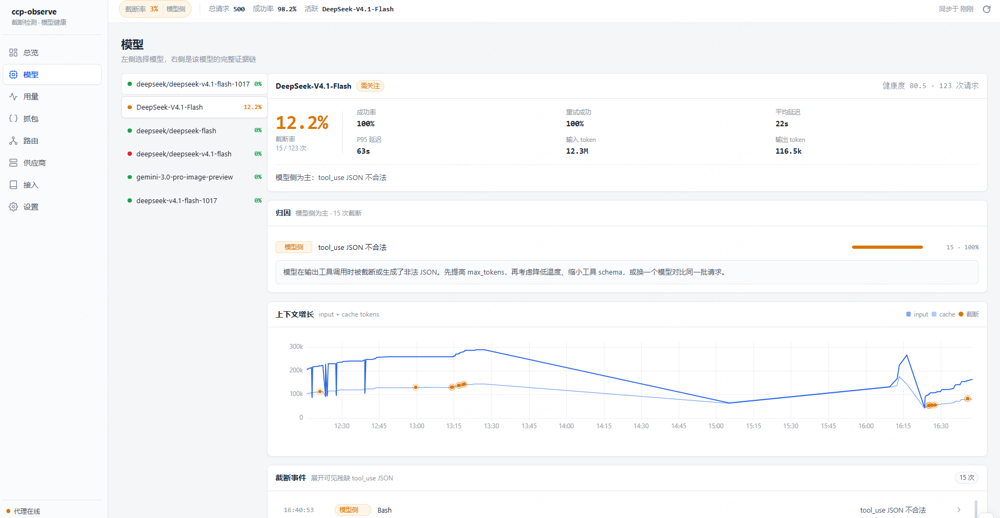
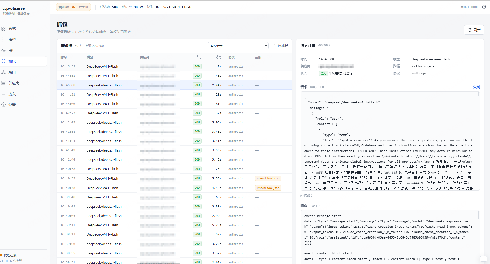
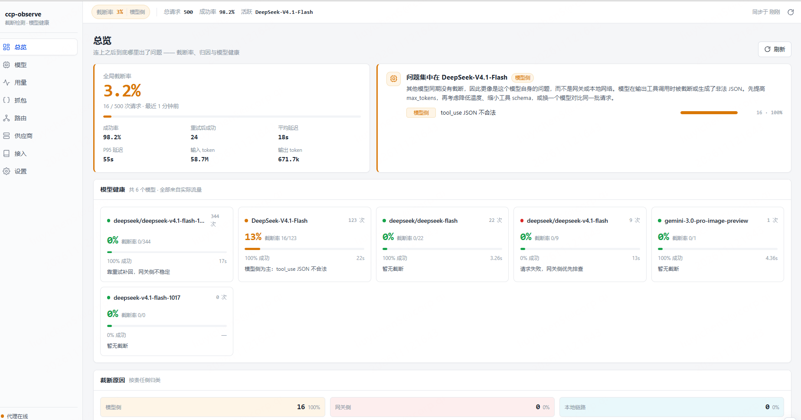
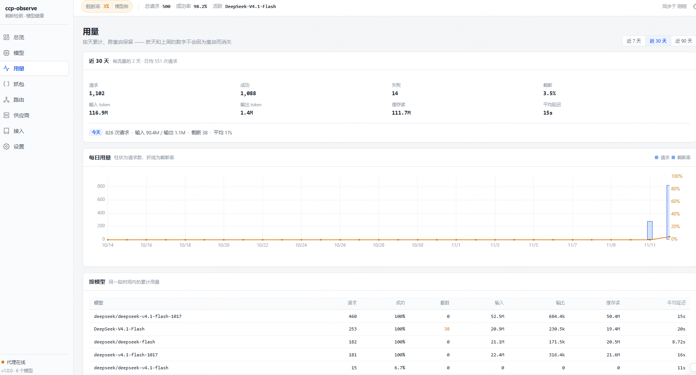

<sub>上游 502、流式响应断在半句话、tool_use 的 JSON 少个括号的时候，差不多就是这个表情。</sub>

<div align="center">


# ccp-observe

夹在 Claude Code / Codex 和上游网关之间的本地观测代理

[](../../releases/latest)
[](LICENSE)
[](https://www.python.org/)
[](#)
[](proxy/tests)

[简体中文](README.md) | [English](README.en.md)

</div>

---

## 这东西是干嘛的

Claude Code 或 Codex 的请求先发到本机的一个端口，再由它转发给真正的上游。面板就挂在这个端口上，所以你能看到每一次请求：用了多少 token、重试了几次、流有没有断、tool_use 的 JSON 是不是缺了半截。

它也能直接当网关用。多个供应商、按模型或路径分流、Anthropic 和 OpenAI 协议互转、完整抓包，这些都有。没有登录，没有云端，也不依赖内网，供应商和上游地址全由你自己填，数据只留在本机。

```
Claude Code ──┐                        ┌── Anthropic 兼容上游
              ├─→ ccp-observe:8787 ────┤
Codex ────────┘   路由 / 转换 / 抓包   └── OpenAI 兼容上游
```

它想回答的问题很具体：一次回复断掉的时候，问题出在模型、网关，还是客户端自己。所以截断率放在总览最显眼的位置，不藏在二级页面里。

面板地址是 `http://127.0.0.1:8787/_ccp/`，由代理直接托管。桌面端在 `desktop/`，用 Tauri 2 写，托盘常驻，内嵌同一个面板。面板源码在 `web/`，构建后写进 `proxy/static/`，所以浏览器和桌面端看到的是同一套页面。

8787 被占用时会自动往后找 8788、8789，并打印一行 `CCP_READY <实际地址>`，桌面端解析后打开对应端口。

## 第一次运行：配置是自动读进来的

`ccp` 启动前会先看本机已有的客户端配置，不需要你重新填一遍：

- Claude Code：读 `~/.claude/settings.json` 和 `settings.local.json`，取 `ANTHROPIC_BASE_URL`、`ANTHROPIC_AUTH_TOKEN` / `ANTHROPIC_API_KEY` 和自定义模型名。
- Codex：读 `~/.codex/config.toml`，取 `model_provider` 指向的 `[model_providers.<id>]`（`base_url`、`env_key`、`wire_api`）以及顶层的 `model`；密钥从 `env_key` 对应的环境变量或 `~/.codex/auth.json` 里取。

读到的上游会写成一条供应商，只导入一次。之后你在面板里改过的配置不会被覆盖，想重新拉一遍就运行 `ccp --reimport`。直接跑 `proxy/proxy.py` 或从桌面端启动时也会做同样的导入，所以不管用哪种方式启动，第一次都不会是一个空的上游列表。

两个客户端都没配置过时，`ccp` 会在终端里问一次 Base URL 和密钥，填完直接落盘；非交互环境就打印该去哪个文件里写，不会卡在一个没人能回答的提示上。

Codex 走的是 Responses API，和 Anthropic Messages 没法互转。如果当前默认供应商不是 OpenAI 协议，`ccp codex` 会自动补一条 `/v1/responses*` 路由，避免请求撞上 `ccp_unsupported_translation`。你自己写的路由永远排在前面。

## 安装

### 源码运行

需要 Python 3.9+。仓库里带了构建好的面板，开箱就能跑。

```bash
git clone <本仓库地址> ccp-observe
cd ccp-observe

# macOS / Linux / Windows Git Bash
chmod +x start.sh && ./start.sh

# Windows PowerShell
Set-ExecutionPolicy -Scope Process -ExecutionPolicy Bypass
.\start.ps1
```

启动脚本会检查 Python，确认面板文件，启动代理，打开面板。第一次使用时它会提示你填上游。

也可以直接跑代理：

```bash
python proxy/proxy.py                      # 127.0.0.1:8787
python proxy/proxy.py --port 8788 --open
python proxy/proxy.py --upstream https://example.internal/v1
```

### Windows 安装包

从 [Releases](../../releases/latest) 下载下面任意一个：

| 文件 | 说明 |
| --- | --- |
| `ccp-observe_1.0.0_x64-setup.exe` | NSIS 安装包，体积小一些 |
| `ccp-observe_1.0.0_x64_en-US.msi` | MSI 安装包，适合企业分发 |

安装时会把 `<安装目录>\resources\bin` 加到当前用户的 PATH，卸载时移除，所以装完新开一个终端就能敲 `ccp`。桌面应用启动时会自己拉起代理，托盘左键显示或隐藏面板，菜单里的“退出（停止代理）”会顺带结束子进程。

安装包自带面板构建产物，目标机器不需要 Node.js，但得有 Python 3.9+。

校验下载文件：`sha256sum -c SHA256SUMS.txt`，PowerShell 用 `Get-FileHash`。

### 让 AI 帮你装

把下面这段发给 Claude Code、Codex、Cursor 之类的助手，它会自己完成安装和验证。前提是你已经装了 Claude Code 或 Codex 中的至少一个。

````text
请在本机安装并配置 ccp-observe（本地 AI 网关观测代理），每一步完成后报告结果：

1. 确认 Python ≥ 3.9（Windows 试 `py -3 --version`），后续命令都在项目根目录执行。
2. 本项目零第三方依赖。如果 proxy/static/index.html 不存在，进入 web/ 执行 `npm ci || npm install` 和 `npm run build`；没有 Node 就跳过。
3. 启动代理：
   - macOS / Linux / Git Bash：`chmod +x start.sh && ./start.sh --no-open`
   - Windows：`Set-ExecutionPolicy -Scope Process -ExecutionPolicy Bypass; .\start.ps1 -NoOpen`
   - 或直接 `python proxy/proxy.py`
   从输出里找到 `CCP_READY http://127.0.0.1:<端口>/_ccp/`，记下实际端口。
4. 验证：`/healthz` 返回 200，`/_ccp/api/stats` 返回 JSON。
5. 接管客户端：运行 `ccp --doctor` 看检查结果，再运行 `ccp`（或 `ccp claude` / `ccp codex`）。
6. 如果 ccp 没能自动导入上游，打开面板「供应商」页手动加一条，协议选 anthropic 或 openai，Base URL 填上游地址，鉴权头填 `Authorization: Bearer <key>`。
7. 冒烟测试：向 `http://127.0.0.1:<端口>/v1/messages` 发一条最小请求，再查 `/_ccp/api/recent?limit=5` 确认能看到。

注意：不要把真实 API key 写进仓库文件或提交记录；不要改 ~/.claude/settings.json 和 ~/.codex/config.toml 的原有内容；Codex 必须路由到 protocol=openai 的供应商。
````

装完之后日常只需要 `ccp`。它会在需要时拉起代理，把选中的客户端指过来，其余保持原样。

## `ccp` 怎么用

```bash
ccp                  # 自动选择已安装的客户端并启动
ccp claude           # 明确用 Claude Code
ccp codex            # 明确用 Codex
ccp --agent list     # 看已安装的客户端和当前默认
ccp --doctor         # 只检查，不启动
ccp --no-launch      # 只确保代理在跑
ccp --reimport       # 用本机客户端配置刷新供应商
ccp --continue       # 客户端参数原样透传
```

只装了一个客户端时直接用它；两个都装了，第一次会问一次，选择记在 `state/agent.json`，之后不再问；脚本或 IDE 这类非交互环境不问，回退到 Claude Code。

`ccp` 实际做的事情：

1. 读 `~/.claude/settings.json` 和 `~/.codex/config.toml`，把找到的上游写成供应商，只导一次。
2. 找一个正在运行的 ccp-observe，找不到就以后台进程拉起一个，关掉终端也继续跑。
3. 确定这次运行哪个客户端。
4. 把客户端指到代理端口，但不改你原来的配置文件：
   - Claude Code：生成一个只含 `ANTHROPIC_BASE_URL` 的临时 settings，用 `claude --settings <文件>` 叠上去。
   - Codex：用 `-c key=value` 覆盖 `model_providers`，`~/.codex/config.toml` 原样不动。
5. 启动客户端，剩余参数全部透传。

所以 `claude` / `codex` 照常直连，`ccp` 走观测代理，两边互不干扰。

## 手动配置客户端

面板「接入」页有一键复制按钮，内容就是下面这些。

Claude Code：

```bash
export ANTHROPIC_BASE_URL=http://127.0.0.1:8787
export ANTHROPIC_AUTH_TOKEN=your-key-if-any
# 上游鉴权在「供应商」页配置，这里放占位值即可
```

Codex 建议直接用 `ccp codex`。手动配置等价于：

```toml
# ~/.codex/config.toml
model_provider = "ccp"
web_search = "disabled"          # 多数兼容网关不接受这个工具，会 400

[model_providers.ccp]
name = "ccp-observe"
base_url = "http://127.0.0.1:8787/v1"
env_key = "OPENAI_API_KEY"
wire_api = "responses"           # Codex 0.16x 起只支持 responses
```

通用 HTTP 客户端：

```bash
curl http://127.0.0.1:8787/v1/messages \
  -H "content-type: application/json" \
  -d '{"model":"your-model","max_tokens":32,"messages":[{"role":"user","content":"hi"}]}'
```

代理按路径识别协议：`/v1/messages` 是 Anthropic Messages，`/v1/chat/completions` 是 OpenAI Chat Completions，`/v1/responses` 是 OpenAI Responses（Codex 走这条）。经过代理的请求都会自动记录。

Codex 必须落到一个 `protocol = openai` 的供应商上。Responses API 和 Anthropic Messages 的报文结构不兼容，转换不了；如果默认供应商是 anthropic 协议，请求会直接返回 `ccp_unsupported_translation` 并说明原因，而不是发一个注定失败的上游请求。在「路由」页加一条规则（比如 `gpt-*` → 某个 openai 供应商）就行。

## 供应商和路由

供应商在面板「供应商」页添加：

| 字段 | 说明 |
| --- | --- |
| 名称 / id | 展示名，id 供路由引用 |
| 协议 | `anthropic` / `openai` / `auto`（跟随客户端） |
| Base URL | 兼容端点，比如 `https://example.internal/v1`，带不带 `/v1` 都行 |
| 鉴权头 | 如 `Authorization: Bearer sk-xxx`，会覆盖客户端带来的同名头 |
| 模型列表 | 可选，声明支持的模型；留空表示兜底 |
| 启用 | 停用后路由会跳过它 |

卡片上有「探活」按钮，发一条最小请求测连通性和延迟，不写入统计。

路由是一组有序规则，从上往下第一条命中的生效。`match` 可以是模型名 glob（`deepseek-*`、`*sonnet*`），也可以是以 `/` 开头的路径 glob。解析顺序：

```
路由规则 → 供应商声明的模型列表 → 默认供应商 → 旧版单上游 → 未配置（502 引导）
```

「路由」页有个命中预览框：输入模型名或路径，它直接告诉你命中哪条规则、落到哪个供应商、要不要转换协议。不用猜。

客户端和供应商协议不一致时，打开「设置 → 协议转换」，代理会逐块改写请求和流式响应：`system` / `messages` / `tools` / `tool_use` / `tool_result` / `max_tokens` 双向映射，`content_block_*` 和 `choices[].delta` 增量互转。上游提前断流时不会伪造结束事件，否则截断会被洗成正常收尾，面板上的数就假了。

配置写在 `proxy/state/config.json`，原子替换，保存立即生效，不用重启。

## 效果图

都是面板实际运行时的窗口截图，不是整页长图，有些内容要往下滚才能看到。

总览：截断率、诊断结论、模型健康度



用量（宽窗口）：按模型和供应商拆分的请求、截断与 token



总览（另一种窗口尺寸）



用量：按天累计的请求、token、延迟和截断率



## 功能

| 模块 | 内容 |
| --- | --- |
| 总览 | 全局截断率大卡、诊断结论、模型健康卡片、按责任侧拆分的截断原因、最近截断 |
| 模型 | 左侧模型列表，右侧单个模型的证据链：截断率、成功率、P95、上下文增长曲线、截断事件（可展开残缺的 tool_use JSON）、最近请求 |
| 用量 | 按天累计请求、成功、失败、截断、输入输出 token、平均延迟；柱状图配截断率折线；再按模型和供应商拆开。数据落盘，重启和关机都不会丢 |
| 抓包 | 每次代理请求的完整请求/响应，头部自动脱敏，可按模型筛选、只看截断；详情页单独拎出残缺的 tool_use 片段 |
| 路由 | 有序规则表、命中预览，改完即时生效 |
| 供应商 | 协议、地址、模型、探活、启用/停用 |
| 接入 | Claude Code / Codex / curl 的环境变量和命令，一键复制 |
| 设置 | 监听地址、重试与保留条数、抓包开关、协议转换、模型名映射、自检 |

几个单独说明的点：

状态栏常驻一条全局截断率，绿黄红三档，在任何页面都能看到。每个截断事件会按原因归到一侧：模型侧（max_tokens、tool_use JSON 不合法）、网关侧（流没正常收尾、上游 5xx 或流内报错）、本地链路（客户端提前断开）。总览的诊断卡做横向对比：只有一个模型出问题，多半是模型侧；多个模型同时出问题，看共享链路；客户端主动断开，就是本地。

抓包是环形缓冲，默认保留最近 200 条。请求头里的 `authorization`、`x-api-key`、`api-key`、`cookie` 一律显示成 `***redacted***`；响应体超过 256 KB 会截断并标注，没截断的 JSON 自动美化。

模型卡片和抓包列表全部来自实际流量，没有写死的模型列表。

## 桌面应用

```bash
cd desktop
npm install                 # 只装 @tauri-apps/cli
npm run bundle-proxy        # 把 proxy/ 复制到 src-tauri/resources
npm run dev                 # 开发运行
npm run build               # 打包（Windows: .msi/.exe；macOS: .dmg）
```

Rust 侧只做三件事：启动/停止 Python 代理子进程、托盘图标、打开面板窗口。

环境要求：

1. Rust 工具链（`rustup`，≥1.77）和 Node.js 18+；
2. Windows 需要 WebView2 Runtime（Win11 自带）以及 WiX/NSIS（`tauri build` 会按需下载）；
3. 目标机器要有 Python 3.9+，或者用 `CCP_PYTHON` 指定解释器路径。

打包前会执行 `scripts/bundle_proxy.mjs`，把 `proxy/` 和 `bin/` 的运行文件复制到 `src-tauri/resources/`。Windows 安装包还会调用 `installer-hooks.nsh`，把 `resources\bin` 加进当前用户 PATH，卸载时移除。

## 目录结构

```
ccp-observe/
├── proxy/                 Python 代理（零第三方依赖）
│   ├── proxy.py           入口，打印 CCP_READY 握手行
│   ├── ccp/
│   │   ├── config.py      配置分层：默认值 → config.json → CCP_* 环境变量
│   │   ├── protocol.py    协议识别、上游 URL 拼接、用量提取
│   │   ├── router.py      供应商解析和有序路由规则（含干跑预览）
│   │   ├── translate.py   Anthropic ⇄ OpenAI 请求和流式响应转换
│   │   ├── capture.py     抓包环形缓冲、请求头脱敏、响应体截断
│   │   ├── truncation.py  SSE 流式截断检测（Anthropic / Chat / Responses）
│   │   ├── stats.py       请求台账和面板聚合
│   │   ├── usage.py       按天落盘的用量台账
│   │   ├── claude_env.py  从 ~/.claude/settings.json 导入上游和鉴权
│   │   ├── codex_env.py   从 ~/.codex/config.toml + auth.json 导入上游和鉴权
│   │   └── server.py      路由、SSE 透传、重试、面板 API
│   ├── ccp_launch.py      `ccp` 命令：导入配置 → 起/复用代理 → 拉起客户端
│   ├── static/            面板构建产物
│   ├── tests/             58 个集成/单元测试
│   ├── demo_upstream.py   本地模拟上游
│   └── seed_demo.py       生成演示流量
├── bin/                   `ccp` 命令包装
├── web/                   面板源码（Vite + 原生 JS + uPlot）
├── desktop/               Tauri 2 桌面端
├── docs/images/           README 截图、图标和表情包
├── start.sh / start.ps1   一键启动脚本
├── README.md              中文说明
├── README.en.md           English README
└── LICENSE                MIT
```

## 面板 API

面板和桌面端都通过相对路径 `/_ccp/api/*` 取数：

| 方法 | 路径 | 说明 |
| --- | --- | --- |
| GET | `/_ccp/api/stats` | 总览、模型聚合、协议配比、状态 |
| GET | `/_ccp/api/recent?model=&limit=` | 最近请求 |
| GET | `/_ccp/api/errors` | 失败请求 |
| GET | `/_ccp/api/truncations?model=` | 截断事件（含 tool_call 片段） |
| GET | `/_ccp/api/context?model=` | 上下文序列 |
| GET | `/_ccp/api/buckets?model=&granularity=day\|week\|month` | 分时段统计 |
| GET | `/_ccp/api/usage?days=` | 按天落盘的用量：days / models / providers / summary |
| GET/POST | `/_ccp/api/config` | 读取或热更新配置 |
| POST | `/_ccp/api/test` | 测试上游连通性（可带 provider id） |
| GET/POST | `/_ccp/api/route?model=&protocol=` | 路由决策预览（干跑） |
| POST | `/_ccp/api/routes/validate` | 校验一条路由规则 |
| GET | `/_ccp/api/capture?model=&limit=&truncated=1` | 抓包列表 |
| GET | `/_ccp/api/capture/<id>` | 单条抓包详情 |
| GET | `/_ccp/api/selftest` | 自检 |
| GET | `/healthz` | 存活探测 |

## 环境变量

| 变量 | 作用 |
| --- | --- |
| `CCP_HOST` / `CCP_PORT` | 监听地址和端口（默认 `127.0.0.1:8787`） |
| `CCP_UPSTREAM` | 通用上游地址 |
| `CCP_UPSTREAM_ANTHROPIC` / `CCP_UPSTREAM_OPENAI` | 按协议区分的上游 |
| `CCP_UPSTREAM_AUTH_HEADER` | 附加到上游请求的鉴权头 |
| `CCP_RETRIES` / `CCP_HISTORY_LIMIT` | 重试次数 / 内存保留条数 |
| `CCP_MODEL_MAP` | `a=b,c=d` 形式的模型映射 |
| `CCP_PROVIDERS_JSON` | 供应商数组的 JSON，覆盖配置文件里的 `providers` |
| `CCP_STATE_DIR` | 配置和状态目录 |
| `CCP_OPEN_PANEL=1` | 启动后自动打开面板 |
| `CCP_PYTHON` | 桌面端和脚本使用的 Python 解释器路径 |

环境变量优先级高于 `config.json`，适合容器或临时切换。

## 开发

```bash
cd proxy && python -m unittest discover -s tests -v     # 58 passed
```

没有真实网关时可以用内置演示上游跑通全流程：

```bash
# 想看到自己的模型名，用 --model 指定，可重复
python proxy/demo_upstream.py --port 9901 --model deepseek-chat --model deepseek-reasoner &
python proxy/proxy.py --upstream http://127.0.0.1:9901 &
python proxy/seed_demo.py --requests 40 --model deepseek-chat --model deepseek-reasoner
# 打开 http://127.0.0.1:8787/_ccp/
```

想看“只有一个模型出问题”的归因效果，只让一个模型截断：

```bash
python proxy/demo_upstream.py --port 9901 --truncate-cut model \
    --truncate-model deepseek-reasoner \
    --model deepseek-chat --model deepseek-reasoner &
```

面板应该给出“模型侧｜问题集中在 deepseek-reasoner”，而 deepseek-chat 的截断率保持 0%。

面板开发：

```bash
cd web
npm install
npm run dev          # Vite 开发服务器，代理到本机 ccp-observe
npm run build        # 输出到 proxy/static/
```

## 一些取舍

- 不绑定任何模型供应商。供应商和上游必须由用户配置，默认留空。
- `ccp` 运行时读取你自己的 `~/.claude/settings.json` 和 `~/.codex/config.toml`，仓库里不保存真实网关地址或 key。
- 不引入 CDN 资源，uPlot 随构建产物打包。
- 不做账号登录、多租户、云端同步。数据只在本地 `state/` 目录，抓包放在内存里。
- 示例地址统一用 `example.internal` 或 `127.0.0.1` 占位。

## 许可证

[MIT](LICENSE)
